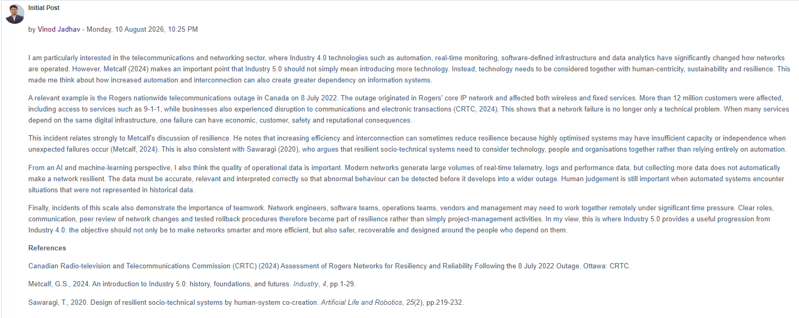

# Collaborative Discussion 1 — Initial Post

**Units 1–3 | Industry 4.0 and Industry 5.0**  
**Posted:** Monday, 10 August 2026, 10:25 PM

I am particularly interested in the telecommunications and networking sector, where Industry 4.0 technologies such as automation, real-time monitoring, software-defined infrastructure and data analytics have significantly changed how networks are operated. However, Metcalf (2024) makes an important point that Industry 5.0 should not simply mean introducing more technology. Instead, technology needs to be considered together with human-centricity, sustainability and resilience. This made me think about how increased automation and interconnection can also create greater dependency on information systems.

A relevant example is the Rogers nationwide telecommunications outage in Canada on 8 July 2022. The outage originated in Rogers’ core IP network and affected both wireless and fixed services. More than 12 million customers were affected, including access to services such as 9-1-1, while businesses also experienced disruption to communications and electronic transactions (CRTC, 2024). This shows that a network failure is no longer only a technical problem. When many services depend on the same digital infrastructure, one failure can have economic, customer, safety and reputational consequences.

This incident relates strongly to Metcalf’s discussion of resilience. He notes that increasing efficiency and interconnection can sometimes reduce resilience because highly optimised systems may have insufficient capacity or independence when unexpected failures occur (Metcalf, 2024). This is also consistent with Sawaragi (2020), who argues that resilient socio-technical systems need to consider technology, people and organisations together rather than relying entirely on automation.

From an AI and machine-learning perspective, I also think the quality of operational data is important. Modern networks generate large volumes of real-time telemetry, logs and performance data, but collecting more data does not automatically make a network resilient. The data must be accurate, relevant and interpreted correctly so that abnormal behaviour can be detected before it develops into a wider outage. Human judgement is still important when automated systems encounter situations that were not represented in historical data.

Finally, incidents of this scale also demonstrate the importance of teamwork. Network engineers, software teams, operations teams, vendors and management may need to work together remotely under significant time pressure. Clear roles, communication, peer review of network changes and tested rollback procedures therefore become part of resilience rather than simply project management activities. In my view, this is where Industry 5.0 provides a useful progression from Industry 4.0: the objective should not only be to make networks smarter and more efficient, but also safer, recoverable and designed around the people who depend on them.

## References

- Canadian Radio-television and Telecommunications Commission (CRTC) (2024) *Assessment of Rogers Networks for Resiliency and Reliability Following the 8 July 2022 Outage*. Ottawa: CRTC.
- Metcalf, G.S. (2024) ‘An introduction to Industry 5.0: history, foundations, and futures’, *Industry*, 4, pp. 1–29.
- Sawaragi, T. (2020) ‘Design of resilient socio-technical systems by human-system co-creation’, *Artificial Life and Robotics*, 25(2), pp. 219–232.

## Original forum evidence

