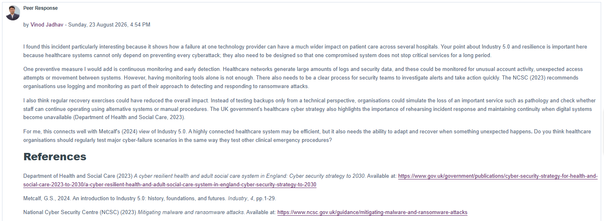
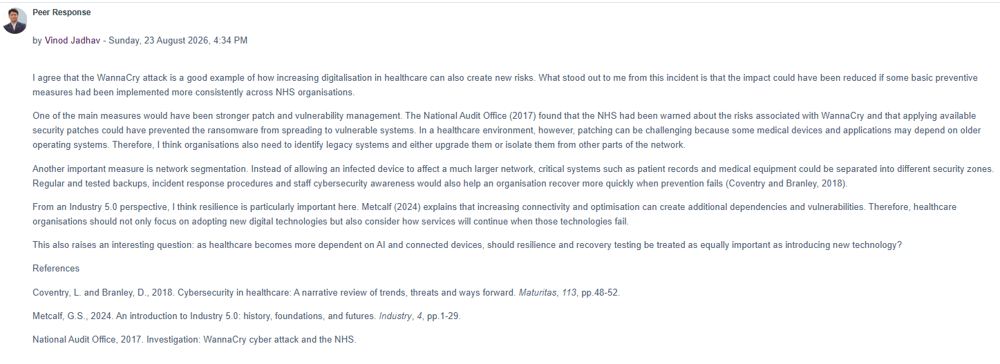

# Collaborative Discussion 1 — My Peer Responses

Both responses were submitted on Sunday, 23 August 2026. The original forum screenshots are included below.

## Response 1 — Healthcare service disruption and resilience

**Posted:** 23 August 2026, 4:54 PM

I found this incident particularly interesting because it shows how a failure at one technology provider can have a much wider impact on patient care across several hospitals. Your point about Industry 5.0 and resilience is important here because healthcare systems cannot only depend on preventing every cyberattack; they also need to be designed so that one compromised system does not stop critical services for a long period.

One preventive measure I would add is continuous monitoring and early detection. Healthcare networks generate large amounts of logs and security data, and these could be monitored for unusual account activity, unexpected access attempts or movement between systems. However, having monitoring tools alone is not enough. There also needs to be a clear process for security teams to investigate alerts and take action quickly. The NCSC (2023) recommends organisations use logging and monitoring as part of their approach to detecting and responding to ransomware attacks.

I also think regular recovery exercises could have reduced the overall impact. Instead of testing backups only from a technical perspective, organisations could simulate the loss of an important service such as pathology and check whether staff can continue operating using alternative systems or manual procedures. The UK government’s healthcare cyber strategy also highlights the importance of rehearsing incident response and maintaining continuity when digital systems become unavailable (Department of Health and Social Care, 2023).

For me, this connects well with Metcalf’s (2024) view of Industry 5.0. A highly connected healthcare system may be efficient, but it also needs the ability to adapt and recover when something unexpected happens. Do you think healthcare organisations should regularly test major cyber-failure scenarios in the same way they test other clinical emergency procedures?

### References for response 1

- Department of Health and Social Care (2023) *A cyber resilient health and adult social care system in England: Cyber security strategy to 2030*. Available at: https://www.gov.uk/government/publications/cyber-security-strategy-for-health-and-social-care-2023-to-2030/a-cyber-resilient-health-and-adult-social-care-system-in-england-cyber-security-strategy-to-2030
- Metcalf, G.S. (2024) ‘An introduction to Industry 5.0: history, foundations, and futures’, *Industry*, 4, pp. 1–29.
- National Cyber Security Centre (NCSC) (2023) *Mitigating malware and ransomware attacks*. Available at: https://www.ncsc.gov.uk/guidance/mitigating-malware-and-ransomware-attacks

## Response 2 — WannaCry and NHS cybersecurity

**Posted:** 23 August 2026, 4:34 PM

I agree that the WannaCry attack is a good example of how increasing digitalisation in healthcare can also create new risks. What stood out to me from this incident is that the impact could have been reduced if some basic preventive measures had been implemented more consistently across NHS organisations.

One of the main measures would have been stronger patch and vulnerability management. The National Audit Office (2017) found that the NHS had been warned about the risks associated with WannaCry and that applying available security patches could have prevented the ransomware from spreading to vulnerable systems. In a healthcare environment, however, patching can be challenging because some medical devices and applications may depend on older operating systems. Therefore, I think organisations also need to identify legacy systems and either upgrade them or isolate them from other parts of the network.

Another important measure is network segmentation. Instead of allowing an infected device to affect a much larger network, critical systems such as patient records and medical equipment could be separated into different security zones. Regular and tested backups, incident response procedures and staff cybersecurity awareness would also help an organisation recover more quickly when prevention fails (Coventry and Branley, 2018).

From an Industry 5.0 perspective, I think resilience is particularly important here. Metcalf (2024) explains that increasing connectivity and optimisation can create additional dependencies and vulnerabilities. Therefore, healthcare organisations should not only focus on adopting new digital technologies but also consider how services will continue when those technologies fail.

This also raises an interesting question: as healthcare becomes more dependent on AI and connected devices, should resilience and recovery testing be treated as equally important as introducing new technology?

### References for response 2

- Coventry, L. and Branley, D. (2018) ‘Cybersecurity in healthcare: A narrative review of trends, threats and ways forward’, *Maturitas*, 113, pp. 48–52.
- Metcalf, G.S. (2024) ‘An introduction to Industry 5.0: history, foundations, and futures’, *Industry*, 4, pp. 1–29.
- National Audit Office (2017) *Investigation: WannaCry cyber attack and the NHS*.

