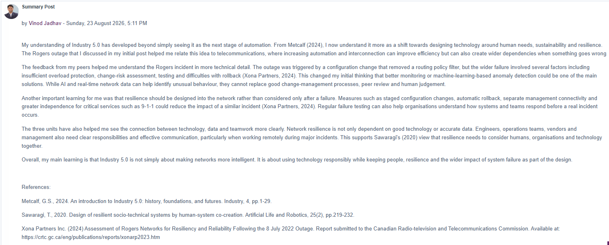

# Collaborative Discussion 1 — Summary Post

**Posted:** Sunday, 23 August 2026, 5:11 PM

My understanding of Industry 5.0 has developed beyond simply seeing it as the next stage of automation. From Metcalf (2024), I now understand it more as a shift towards designing technology around human needs, sustainability and resilience. The Rogers outage that I discussed in my initial post helped me relate this idea to telecommunications, where increasing automation and interconnection can improve efficiency but can also create wider dependencies when something goes wrong.

The feedback from my peers helped me understand the Rogers incident in more technical detail. The outage was triggered by a configuration change that removed a routing policy filter, but the wider failure involved several factors including insufficient overload protection, change-risk assessment, testing and difficulties with rollback (Xona Partners, 2024). This changed my initial thinking that better monitoring or machine-learning-based anomaly detection could be one of the main solutions. While AI and real-time network data can help identify unusual behaviour, they cannot replace good change-management processes, peer review and human judgement.

Another important learning for me was that resilience should be designed into the network rather than considered only after a failure. Measures such as staged configuration changes, automatic rollback, separate management connectivity and greater independence for critical services such as 9-1-1 could reduce the impact of a similar incident (Xona Partners, 2024). Regular failure testing can also help organisations understand how systems and teams respond before a real incident occurs.

The three units have also helped me see the connection between technology, data and teamwork more clearly. Network resilience is not only dependent on good technology or accurate data. Engineers, operations teams, vendors and management also need clear responsibilities and effective communication, particularly when working remotely during major incidents. This supports Sawaragi's (2020) view that resilience needs to consider humans, organisations and technology together.

Overall, my main learning is that Industry 5.0 is not simply about making networks more intelligent. It is about using technology responsibly while keeping people, resilience and the wider impact of system failure as part of the design.

## References

- Metcalf, G.S. (2024) ‘An introduction to Industry 5.0: history, foundations, and futures’, *Industry*, 4, pp. 1–29.
- Sawaragi, T. (2020) ‘Design of resilient socio-technical systems by human-system co-creation’, *Artificial Life and Robotics*, 25(2), pp. 219–232.
- Xona Partners Inc. (2024) *Assessment of Rogers Networks for Resiliency and Reliability Following the 8 July 2022 Outage*. Report submitted to the Canadian Radio-television and Telecommunications Commission. Available at: https://crtc.gc.ca/eng/publications/reports/xonarp2023.htm

## Original forum evidence

