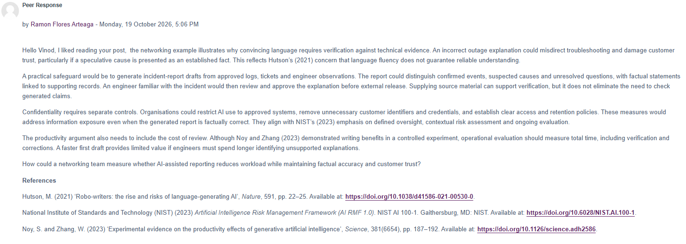

# Collaborative Discussion 2 — Feedback Received

**Source:** Reply from Ramon Flores Arteaga to my initial post, 19 October 2026, 5:06 PM.

Ramon commented that my networking example illustrated why convincing AI-generated language must be checked against technical evidence. He developed several practical safeguards: use approved incident logs, tickets and engineer observations; distinguish verified facts from suspected causes and unresolved questions; and have a knowledgeable engineer review reports before release.

He also highlighted protecting confidentiality by using approved systems, removing unnecessary customer identifiers and credentials, and adopting access and retention rules. Finally, he challenged a simple productivity argument: faster initial drafting may not save time if verification and correction take longer. He asked how a networking team could measure workload reduction while maintaining factual accuracy and customer trust.

## What I took from this feedback

The feedback gave me a more concrete way to evaluate AI-assisted writing. I would measure not just draft creation time, but review effort, corrections, factual errors and whether the report is supported by operational records. I would also separate factual verification from confidentiality safeguards because one does not replace the other.

*The feedback screenshot is retained as the primary record. This document is a summary, not a verbatim transcript.*
