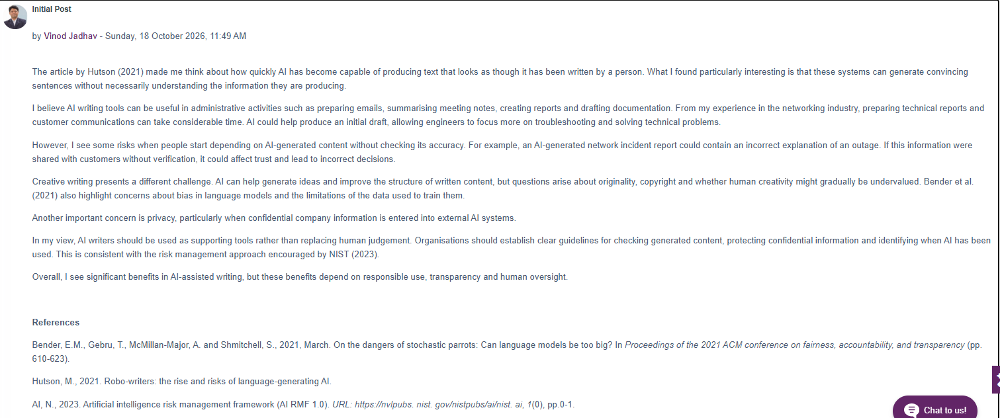

# Collaborative Discussion 2 — Initial Post

**Submitted:** 18 October 2026

The article by Hutson (2021) made me think about how quickly AI has become capable of producing text that looks as though it has been written by a person. What I found particularly interesting is that these systems can generate convincing sentences without necessarily understanding the information they are producing.

I believe AI writing tools can be useful in administrative activities such as preparing emails, summarising meeting notes, creating reports and drafting documentation. From my experience in the networking industry, preparing technical reports and customer communications can take considerable time. AI could help produce an initial draft, allowing engineers to focus more on troubleshooting and solving technical problems.

However, I see some risks when people start depending on AI-generated content without checking its accuracy. For example, an AI-generated network incident report could contain an incorrect explanation of an outage. If this information were shared with customers without verification, it could affect trust and lead to incorrect decisions.

Creative writing presents a different challenge. AI can help generate ideas and improve the structure of written content, but questions arise about originality, copyright and whether human creativity might gradually be undervalued. Bender et al. (2021) also highlight concerns about bias in language models and the limitations of the data used to train them.

Another important concern is privacy, particularly when confidential company information is entered into external AI systems.

In my view, AI writers should be used as supporting tools rather than replacing human judgement. Organisations should establish clear guidelines for checking generated content, protecting confidential information and identifying when AI has been used. This is consistent with the risk management approach encouraged by NIST (2023).

Overall, I see significant benefits in AI-assisted writing, but these benefits depend on responsible use, transparency and human oversight.

References

Bender, E.M., Gebru, T., McMillan-Major, A. and Shmitchell, S., 2021, March. On the dangers of stochastic parrots: Can language models be too big?. In Proceedings of the 2021 ACM conference on fairness, accountability, and transparency (pp. 610-623).

Hutson, M., 2021. Robo-writers: the rise and risks of language-generating AI.

AI, N., 2023. Artificial intelligence risk management framework (AI RMF 1.0). URL: https://nvlpubs. nist. gov/nistpubs/ai/nist. ai, 1(0), pp.0-1.

