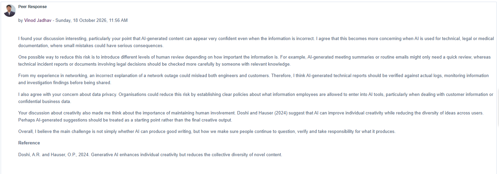
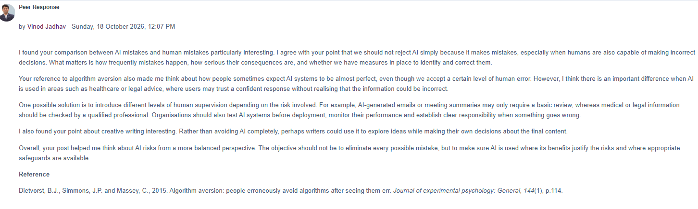

# Collaborative Discussion 2 — My Peer Responses

## Response 1 — AI writing accuracy, privacy and creativity

**Submitted:** 18 October 2026, 11:56 AM

I found your discussion interesting, particularly your point that AI-generated content can appear very confident even when the information is incorrect. I agree that this becomes more concerning when AI is used for technical, legal or medical documentation, where small mistakes could have serious consequences.

One possible way to reduce this risk is to introduce different levels of human review depending on how important the information is. For example, AI-generated meeting summaries or routine emails might only need a quick review, whereas technical incident reports or documents involving legal decisions should be checked more carefully by someone with relevant knowledge.

From my experience in networking, an incorrect explanation of a network outage could mislead both engineers and customers. Therefore, I think AI-generated technical reports should be verified against actual logs, monitoring information and investigation findings before being shared.

I also agree with your concern about data privacy. Organisations could reduce this risk by establishing clear policies about what information employees are allowed to enter into AI tools, particularly when dealing with customer information or confidential business data.

Your discussion about creativity also made me think about the importance of maintaining human involvement. Doshi and Hauser (2024) suggest that AI can improve individual creativity while reducing the diversity of ideas across users. Perhaps AI-generated suggestions should be treated as a starting point rather than the final creative output.

Overall, I believe the main challenge is not simply whether AI can produce good writing, but how we make sure people continue to question, verify and take responsibility for what it produces.

Reference

Doshi, A.R. and Hauser, O.P., 2024. Generative AI enhances individual creativity but reduces the collective diversity of novel content.

## Response 2 — AI mistakes, human judgement and accountability

**Submitted:** 18 October 2026, 12:07 PM

I found your comparison between AI mistakes and human mistakes particularly interesting. I agree with your point that we should not reject AI simply because it makes mistakes, especially when humans are also capable of making incorrect decisions. What matters is how frequently mistakes happen, how serious their consequences are, and whether we have measures in place to identify and correct them.

Your reference to algorithm aversion also made me think about how people sometimes expect AI systems to be almost perfect, even though we accept a certain level of human error. However, I think there is an important difference when AI is used in areas such as healthcare or legal advice, where users may trust a confident response without realising that the information could be incorrect.

One possible solution is to introduce different levels of human supervision depending on the risk involved. For example, AI-generated emails or meeting summaries may only require a basic review, whereas medical or legal information should be checked by a qualified professional. Organisations should also test AI systems before deployment, monitor their performance and establish clear responsibility when something goes wrong.

I also found your point about creative writing interesting. Rather than avoiding AI completely, perhaps writers could use it to explore ideas while making their own decisions about the final content.

Overall, your post helped me think about AI risks from a more balanced perspective. The objective should not be to eliminate every possible mistake, but to make sure AI is used where its benefits justify the risks and where appropriate safeguards are available.

Reference

Dietvorst, B.J., Simmons, J.P. and Massey, C., 2015. Algorithm aversion: people erroneously avoid algorithms after seeing them err. Journal of experimental psychology: General, 144(1), p.114.

