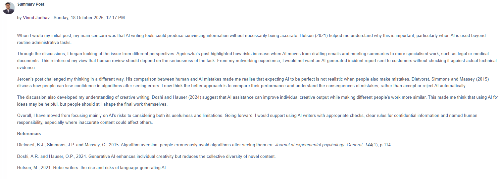

# Collaborative Discussion 2 — Summary Post

**Submitted:** 18 October 2026, 12:17 PM

When I wrote my initial post, my main concern was that AI writing tools could produce convincing information without necessarily being accurate. Hutson (2021) helped me understand why this is important, particularly when AI is used beyond routine administrative tasks.

Through the discussions, I began looking at the issue from different perspectives. Agnieszka’s post highlighted how risks increase when AI moves from drafting emails and meeting summaries to more specialised work, such as legal or medical documents. This reinforced my view that human review should depend on the seriousness of the task. From my networking experience, I would not want an AI-generated incident report sent to customers without checking it against actual technical evidence.

Jeroen’s post challenged my thinking in a different way. His comparison between human and AI mistakes made me realise that expecting AI to be perfect is not realistic when people also make mistakes. Dietvorst, Simmons and Massey (2015) discuss how people can lose confidence in algorithms after seeing errors. I now think the better approach is to compare their performance and understand the consequences of mistakes, rather than accept or reject AI automatically.

The discussion also developed my understanding of creative writing. Doshi and Hauser (2024) suggest that AI assistance can improve individual creative output while making different people’s work more similar. This made me think that using AI for ideas may be helpful, but people should still shape the final work themselves.

Overall, I have moved from focusing mainly on AI’s risks to considering both its usefulness and limitations. Going forward, I would support using AI writers with appropriate checks, clear rules for confidential information and named human responsibility, especially where inaccurate content could affect others.

## References

- Dietvorst, B.J., Simmons, J.P. and Massey, C. (2015) ‘Algorithm aversion: people erroneously avoid algorithms after seeing them err’, *Journal of Experimental Psychology: General*, 144(1), p.114.
- Doshi, A.R. and Hauser, O.P. (2024) ‘Generative AI enhances individual creativity but reduces the collective diversity of novel content’.
- Hutson, M. (2021) ‘Robo-writers: the rise and risks of language-generating AI’.

