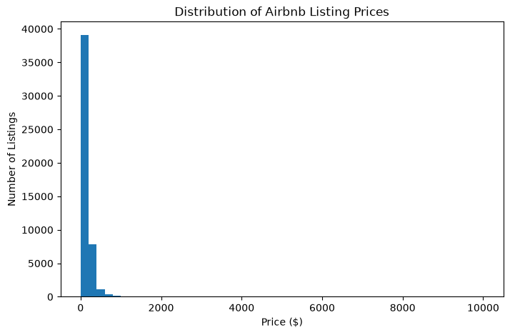
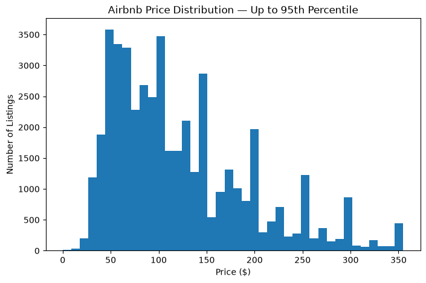
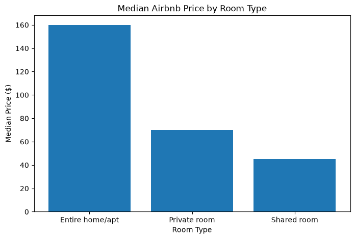
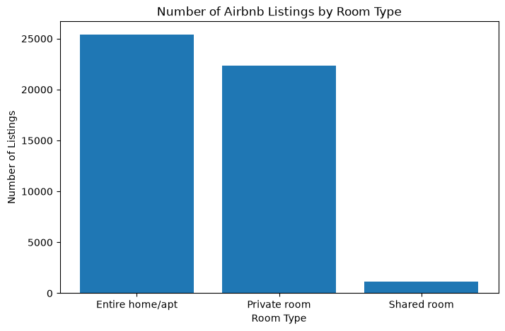
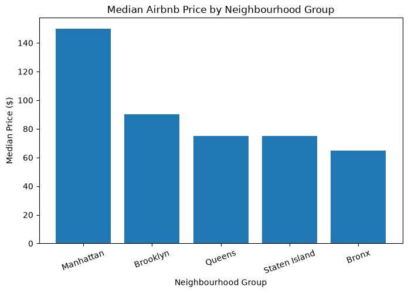
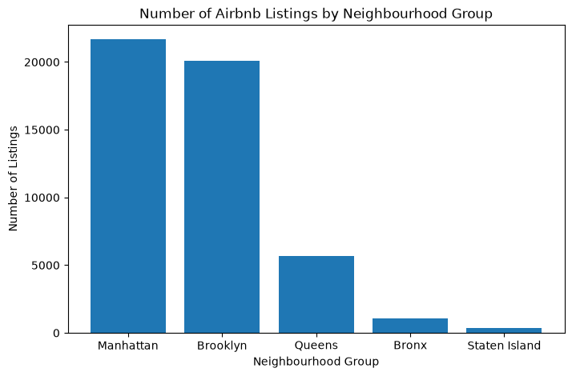

# My individual contribution — Data understanding and EDA

My allocated contribution to Group D was to inspect the Airbnb NYC dataset and prepare exploratory analysis that the team could use when choosing variables, writing the report and interpreting later models. The Trello board lists **EDA** under my initials (VJ); the two notebooks below provide the technical work.

## 1. Understanding the raw data

I inspected the dataset shape (**48,895 × 16**), data types, missing values, duplicates and numerical summaries. There were no duplicated rows and the listing IDs were unique. Missing values were concentrated in `name` (16), `host_name` (21), `last_review` (10,052) and `reviews_per_month` (10,052). In the data-understanding notebook, I checked that records with missing review fields had `number_of_reviews = 0` and flagged **11 zero-price records** for modelling review. These checks helped distinguish missing review history from arbitrary missing data.

[Open the data-understanding notebook](notebooks/01_data_understanding.ipynb)

## 2. Exploring prices and outliers

The mean listing price (**$152.72**) exceeded the median (**$106**), signalling a right-skewed distribution. I made both a full-price histogram and a view limited to the **95th percentile ($355)**, so extreme prices did not conceal the common listing range. The 95th-percentile view was **for visualisation only**, not evidence that all higher-price records were removed from the model.

## 3. Room-type patterns

I compared counts and median prices for the three room types. Entire homes/apartments had the highest median (**$160**), followed by private rooms (**$70**) and shared rooms (**$45**). This suggested room type should be considered in subsequent pricing analysis.

## 4. Neighbourhood/location patterns

I compared listing volumes and typical prices across boroughs. Manhattan had the highest median (**$150**), while the Bronx had the lowest (**$65**). The data were concentrated in Manhattan and Brooklyn, so the geographic coverage was not balanced. My [location decision note](eda-location-decision.md) recorded that `neighbourhood_group` should remain a candidate predictor and that `neighbourhood` contains **221 distinct categories**, potentially offering detail at the cost of model complexity. I did not remove or transform location fields during EDA.

[Open the EDA notebook](notebooks/02_eda.ipynb)

## What changed in my understanding

I initially thought EDA mainly meant producing statistics and graphs. It became clearer that checking missingness, looking at skew and selecting appropriate summaries help the group avoid misleading conclusions. I also learned why it matters to separate **an EDA observation** from a **modelling decision**, which should be taken and verified later in the project.

*Reproduction note:* The notebooks refer to `../data/raw/AB_NYC_2019.csv`, which is not included in this evidence bundle. A local copy of that source dataset at the expected path is needed to rerun them.
