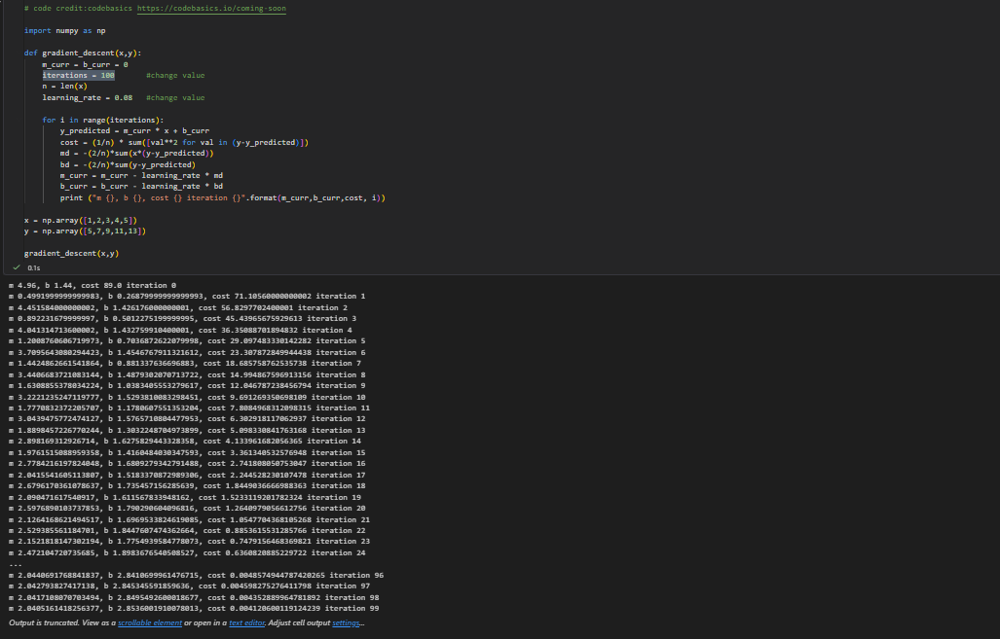
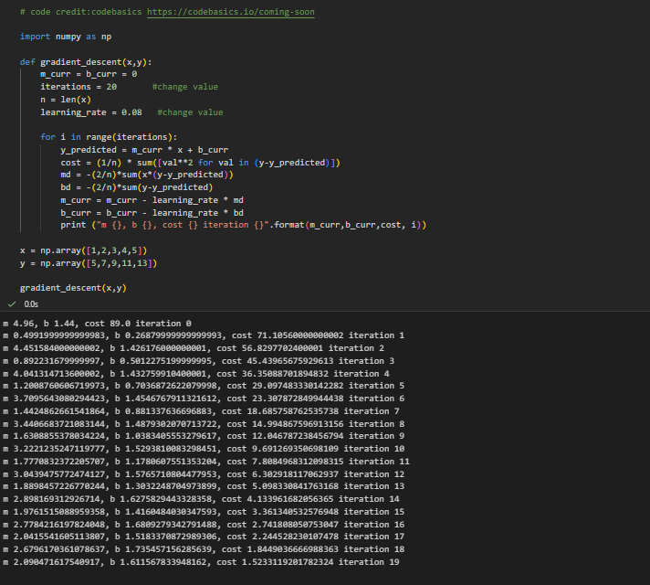
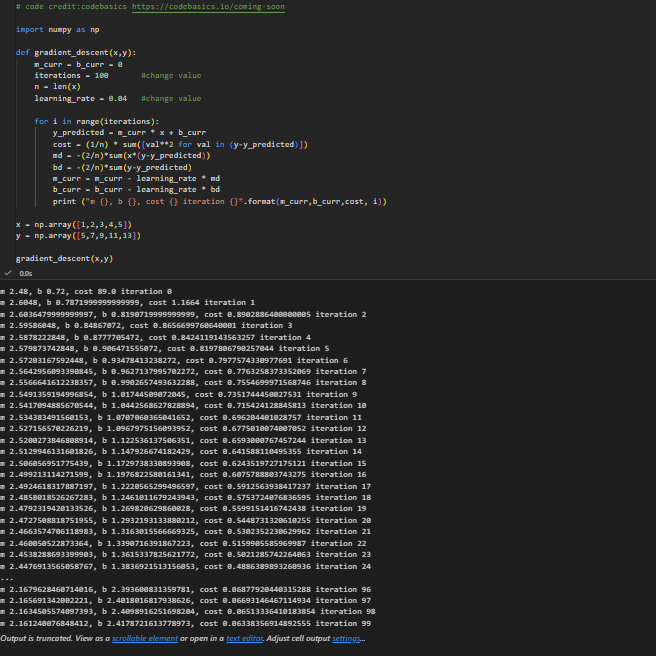

# Unit 8 — Gradient Descent and Cost Function: Completed Activity

## Activity and objective

The Unit 8 tutorial, `Unit08 Ex4 gradient_descent_cost_function.ipynb`, asks us to change the number of iterations and the learning rate, and observe how the cost changes. I completed an original run and two controlled modifications. The activity helped me understand the role of these training settings rather than treating them as numbers to change without a reason.

**Learning outcome:** Understand the applicability and challenges associated with different datasets for the use of machine learning algorithms.

## How the supplied notebook works

The notebook uses five example data points:

```python
x = np.array([1, 2, 3, 4, 5])
y = np.array([5, 7, 9, 11, 13])
```

It fits a straight line using the model `y_predicted = m_curr * x + b_curr`. Both `m_curr` (slope) and `b_curr` (intercept) start at zero. During each iteration, the algorithm calculates the mean squared error (cost), calculates gradients for the two parameters and updates them using the learning rate. It prints the slope, intercept, cost and iteration number. **The cost printed on each line is calculated before that line's parameter update.**

A lower cost means the fitted line is closer to the five example observations under this squared-error measure. It does not, on its own, prove that a model will generalise to new data.

## My three experiments

I changed one setting at a time to make the comparison easier to understand. All three runs use the same data and the same initial values (`m_curr = b_curr = 0`).

| Experiment | Iterations | Learning rate | Last printed iteration | Last printed cost |
|---|---:|---:|---:|---:|
| Original | 100 | 0.08 | 99 | 0.0041206001 |
| Modified 1 — fewer iterations | 20 | 0.08 | 19 | 1.5233119202 |
| Modified 2 — smaller learning rate | 100 | 0.04 | 99 | 0.0633835691 |

*The cost figures above are independently reproducible from the original notebook's code and data. The screenshots saved during my runs provide the practical evidence; the precise figures should be checked against those images if the local notebook was edited in other ways.*

### Experiment 1 — Original settings

I ran the supplied example with `iterations = 100` and `learning_rate = 0.08`. The final printed cost was approximately `0.00412`, showing that the model reduced the squared prediction error substantially over training.



### Experiment 2 — Reduce iterations to 20

I kept the learning rate at `0.08` and reduced the iterations to `20`. The final printed cost was approximately `1.52331`, much higher than for the 100-iteration run. This shows that stopping early can leave the model further from a low-cost solution.



### Experiment 3 — Reduce learning rate to 0.04

I restored the iterations to `100` and reduced the learning rate from `0.08` to `0.04`. The final printed cost was approximately `0.06338`. With the same number of iterations, the smaller updates made slower progress towards a low-cost solution in this particular example.



## What I learned from the comparison

The **number of iterations** controls how long the optimisation process continues, while the **learning rate** controls the size of parameter changes. There is a balance: too few iterations may stop training early, while a learning rate that is too small may require additional iterations. However, a larger learning rate is not always better; large steps can overshoot a minimum or make training unstable.

I also noticed the dataset used here is very small and follows a simple straight-line relationship. This makes it suitable for learning how the algorithm works, but it is not a realistic test of issues such as noise, outliers, missing values or generalisation. Those issues would matter when selecting and tuning a machine learning algorithm for a real dataset.

## Seminar discussion points

- Why did 20 iterations leave a higher cost than 100 iterations when the learning rate stayed the same?
- Why did learning rate `0.04` make less progress than `0.08` in 100 iterations?
- What could happen if the learning rate were made excessively large?
- Would the same settings behave equally well on a noisy or much larger dataset?

## Evidence files

- Original notebook: `Unit08 Ex4 gradient_descent_cost_function.ipynb` (keep a copy of the actual executed notebook alongside this activity)
- `screenshots/ex4-gradient-original.png`
- `screenshots/ex4-gradient-iterations-20.png`
- `screenshots/ex4-gradient-learning-rate-004.png`
- [My Unit 8 reflection](reflection.md)

## Reading note

The unit also requires Mayo (2017). This activity record describes the notebook experiment only. The reading has not been independently reviewed or evidenced here; I should not claim it as completed until I have read and noted its main points.

**Notebook provenance:** University unit-provided exercise; code attributes its example to codebasics (`https://codebasics.io/coming-soon`).
