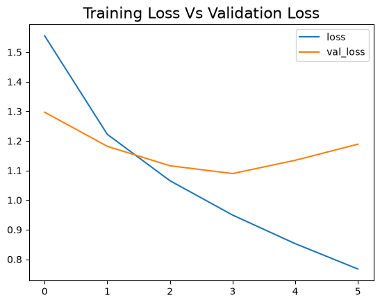
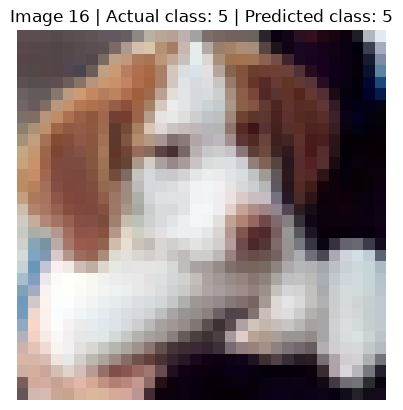
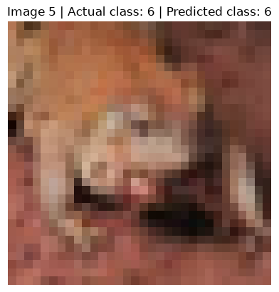
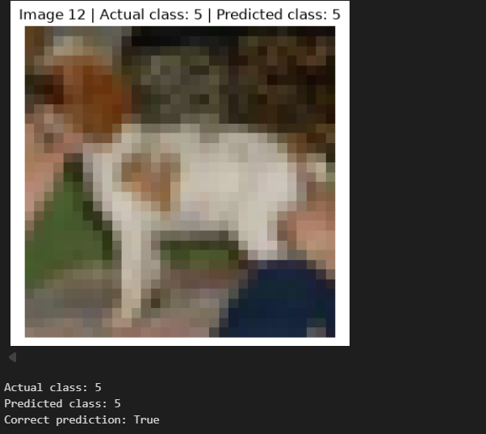

# Unit 9 — Convolutional Neural Networks (CNN): Object Recognition

## Activity and aim

I ran the provided **Unit09 Ex1 Convolutional Neural Networks (CNN) - Object Recognition** Jupyter notebook using the **CIFAR-10** image dataset. The task was to inspect the CNN, change the image index used for a prediction from `x_test[16]` to another index between 1 and 15, and compare the predicted and actual labels.

The notebook loads and preprocesses colour images, creates training and validation sets, builds a convolutional neural network, trains it with early stopping, evaluates performance on held-out test images, and predicts individual images. The model contains convolutional and pooling layers followed by classification layers.

## Training and evaluation

The model was configured for up to **25 epochs**, with early stopping. In my saved run it trained for **6 epochs**. The training-loss curve continued decreasing, whereas validation loss reached its lowest value around epoch 4 and then increased. This suggests that the model began fitting the training examples better without corresponding improvement on validation data — an indication of possible overfitting.

The notebook's test-set evaluation reported **accuracy of 0.6242 (62.42%)** and **test loss of approximately 1.1997**. Therefore, although the individual examples below were predicted correctly, the model did not classify every test image correctly.

## Original and modified image predictions

For each image, I compared the true CIFAR-10 class in `y_test` with the model's predicted class. CIFAR-10 label **5** is *dog* and label **6** is *frog*.

| Test-image index | Actual class | Predicted class | Correct? | Experiment |
|---|---|---|---|---|
| `x_test[16]` | 5 — Dog | 5 — Dog | Yes | Original |
| `x_test[5]` | 6 — Frog | 6 — Frog | Yes | Modified 1 |
| `x_test[12]` | 5 — Dog | 5 — Dog | Yes | Modified 2 |

### Original: image 16

### Modified 1: image 5

### Modified 2: image 12

I changed **only the selected test image** for these comparisons; I did not retrain the model for each image. Because the older notebook used `predict_classes()`, which is not available in recent Keras versions, I used `model.predict()` and `np.argmax()` to select the predicted class.

## Findings and limitations

The trained model correctly recognised these three examples, including a frog and two dogs. However, **three correct predictions do not demonstrate 100% overall accuracy**. The 62.42% test accuracy is a more representative measure across the held-out test set. The loss curves also indicate the importance of monitoring validation performance rather than focusing only on training loss.

CIFAR-10 images are small (**32 × 32 pixels**), which makes details difficult to distinguish. Results can depend on how well the training data represent objects and conditions that the model encounters. These limitations matter when applying image recognition outside a classroom dataset.

## Evidence files

- [Executed CNN notebook](Unit09%20Ex1%20Convolutional%20Neural%20Networks%20%28CNN%29%20-%20Object%20Recognition%20%281%29.ipynb)
- [Learning reflection](reflection.md)
- [Training-loss graph](screenshots/ex1-cnn-training-loss.png)
- [Original image 16](screenshots/ex1-cnn-original-16.png)
- [Modified image 5](screenshots/ex1-cnn-modified-5.png)
- [Modified image 12](screenshots/ex1-cnn-modified-12.png)

**Note:** The notebook hyperlink assumes its filename in this folder ends in ` (1).ipynb`; update this link if you rename the notebook.
